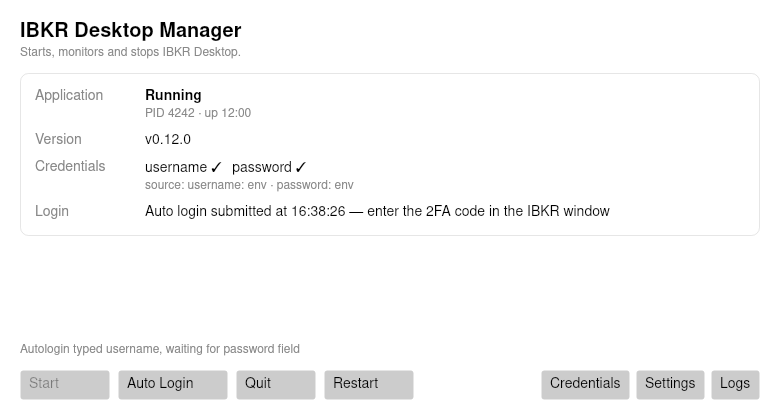

# IBKR Desktop Manager

A small Windows app that starts, watches and stops **IBKR Desktop** (`ntws.exe`), and can type
your credentials into the login window on demand — without ever writing them to disk unless you
explicitly ask it to.

[](https://github.com/cainiaocome/ibkr-desktop-manager/actions/workflows/ci.yml)
[](https://github.com/cainiaocome/ibkr-desktop-manager/actions/workflows/release.yml)
[](LICENSE)



## Why

IBKR Desktop has no supported way to launch and sign in from a script, and no way to see whether
it is installed, running or stuck at the login screen. This manager gives you:

- live status: installed version, process/PID/uptime, whether credentials are available (and from where),
  whether the app sits at the login screen, is waiting for 2FA, or is logged in;
- **Start / Quit / Restart** with a graceful close and a process-tree fallback, plus a kill-on-close
  job object so an orphaned trading session can never outlive the manager;
- an explicit **Auto Login** button that launches the app if needed and types the credentials —
  and refuses with a clear error when none are configured;
- a **Credentials** dialog that stores the password in Windows Credential Manager (DPAPI), with an
  opt-in "also write environment variables" escape hatch;
- no telemetry, no network calls, no background services.

## Install

1. Download `IbkrDesktopManager-<version>-win-x64.zip` from the
   [latest release](https://github.com/cainiaocome/ibkr-desktop-manager/releases/latest).
2. Extract it anywhere and run `IbkrDesktopManager.exe`.
3. Verify the download: `SHA256SUMS` is published next to the zip.

Nothing is installed system-wide, no admin rights are needed, and uninstalling is deleting the
folder (plus `%LOCALAPPDATA%\IbkrManager` if you want the settings and logs gone).

> The binaries are **unsigned**, so Windows SmartScreen will warn on first launch
> ("More info" → "Run anyway"). Verify the SHA-256 hash if that bothers you.

Requires Windows 10/11 x64 and [IBKR Desktop](https://www.interactivebrokers.com/en/trading/ibkr-desktop-download.php)
installed (the manager finds it via the registry, `C:\Program Files\IBKR Desktop` or `C:\ntws`).

## Credentials

Resolution order, first hit wins, and the UI always shows the effective source:

| # | Source | Where it is stored |
|---|---|---|
| 1 | `IBKR_USERNAME` / `IBKR_PASSWORD` in the **process** environment | nowhere — it is what you launched the manager with |
| 2 | the same names in the **user** environment (HKCU\Environment) | plaintext in the registry, only if you opt in |
| 3 | **Windows Credential Manager** entries written by the Credentials dialog | DPAPI, per user |
| 4 | values typed into the dialog for this session only | memory |

```powershell
# one-off, nothing persisted
$env:IBKR_USERNAME = "your-account"
$env:IBKR_PASSWORD = "your-password"
.\IbkrDesktopManager.exe
```

The password is deliberately **not** stored in an environment variable by default: env vars are
plaintext in the registry, inherited by every child process (including IBKR Desktop), and easy to
leak into logs and crash dumps. Usernames are not secret, so both are fine there.

**Auto Login never bypasses 2FA.** IBKR will still ask for a security code; the manager stops at
"Awaiting 2FA" and tells you to finish in the app.

## Using it

| Button | What it does |
|---|---|
| Start | Launches IBKR Desktop and waits for the login window |
| Auto Login | Launches if needed, then types username → Tab → password → Enter |
| Quit | `WM_CLOSE` first, then kills the process tree if it does not exit in 15 s |
| Restart | Quit, then Start |
| Credentials | Add / replace / clear stored credentials |
| Settings | Executable path override, env var names, login driver (`sendinput` or `manual`) |
| Logs | Opens `%LOCALAPPDATA%\IbkrManager\logs` |

The window refreshes every 2 seconds. Closing the manager also stops the IBKR Desktop instance it
started (that is the kill-on-close job object doing its job).

## Security model

- Credentials live in `Secret` objects whose `ToString()` is `***`; logs pass through a redactor that
  scrubs known values as a second line of defence.
- The password is never put on a command line (visible in the process list), never in the launched
  app's environment, and never in `settings.json`.
- Settings contain paths and variable *names* only.
- `Auto Login` is only ever triggered by your click — there is no automatic login on start.

## Development

```bash
dotnet build                       # whole solution
dotnet test                        # 109 tests: core, platform, view models, headless UI render, Windows integration
dotnet format IbkrDesktopManager.sln --verify-no-changes
dotnet run --project src/IbkrManager.App
```

- `src/IbkrManager.Core` — state machine, credential resolution, settings, logging. No P/Invoke.
- `src/IbkrManager.Platform.Windows` — registry lookup, process/job control, SendInput, Credential Manager.
- `src/IbkrManager.App` — Avalonia UI (MVVM), two dialogs.
- `src/IbkrManager.TestHost` — a WinForms stand-in for IBKR Desktop (`ibkr-testhost.exe`) used by the
  integration tests; only executed on Windows.
- `tests/*` — xUnit; the UI render tests capture `docs/images/*.png` headlessly, so a XAML regression
  shows up as a diffable screenshot.

Everything except the platform layer builds and tests on Linux/macOS. The Windows APIs are exercised
by the `windows-latest` CI job, which runs the manager against the stub app for real.

### What is verified where

| Area | Linux/macOS | `windows-latest` CI | Interactive Windows session |
|---|---|---|---|
| State machine, credential chain, redaction | unit tests | unit tests | — |
| Credential Manager, HKCU\Environment | skip | real Win32 round-trip | — |
| Registry discovery, launch/attach, window classification | skip | **real integration tests** | — |
| Graceful `WM_CLOSE` quit, process-tree kill | skip | **real integration tests** | — |
| `SendInput` keystrokes reaching a focused field | sequence unit tests (faked keyboard) | not delivered¹ | **integration test** |

¹ Hosted Windows runners are service sessions: windows exist and can be focused, but there is no
input desktop, so synthetic keystrokes are dropped. Run the typing check on a console/RDP session or
a self-hosted interactive runner:

```powershell
dotnet test tests/IbkrManager.IntegrationTests -c Release --filter "Category=InteractiveDesktop"
```

See [docs/design.md](docs/design.md) for the architecture, [docs/usage.md](docs/usage.md) for the user
guide, and [docs/ibkr-app-notes.md](docs/ibkr-app-notes.md) for what still needs a real IBKR Desktop
install to confirm.

## Releasing

Push a `v*.*.*` tag: the `Release` workflow builds, tests, publishes a self-contained `win-x64`
bundle, zips it with `SHA256SUMS`, attests provenance and creates the GitHub release.
Signing activates automatically if the `SIGNING_ENABLED` repository variable is `true` and the
`SIGNING_CERT_BASE64` / `SIGNING_CERT_PASSWORD` secrets exist.

## Disclaimer

Not affiliated with Interactive Brokers. This tool drives a UI that IBKR does not support automating;
it can break when the app changes. 2FA is never bypassed, and you are responsible for your
credentials and for complying with IBKR's terms. MIT licensed, no warranty.
