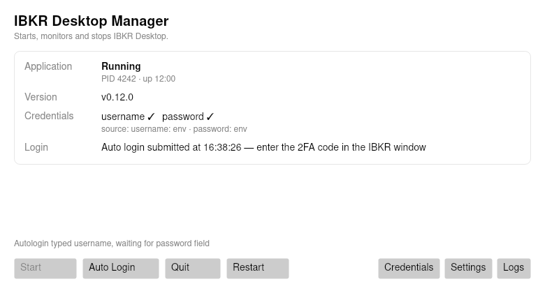
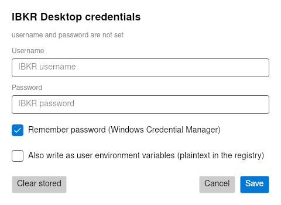
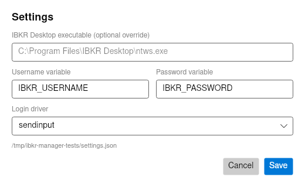

# Using IBKR Desktop Manager

## First run

1. Extract the zip and start `IbkrDesktopManager.exe` (no installer, no admin rights).
2. The status card tells you whether IBKR Desktop was found. If it says *Not installed*, either
   install IBKR Desktop or point the manager at `ntws.exe` via **Settings → executable override**.
3. Press **Start**. The manager launches the app and waits for its login window.
4. Log in as usual, or configure credentials (§2) and press **Auto Login**.

The window is a live view: it refreshes every 2 seconds and never blocks while a command runs.

## 1. States

| Status | Meaning |
|---|---|
| Not installed | `ntws.exe` was not found in the registry or the known folders |
| Not running | Installed, process not running |
| Starting… | Just launched; waiting for the window to appear (up to 2 minutes) |
| At login screen | Window up, login form detected — log in manually or press Auto Login |
| Awaiting 2FA | Credentials accepted; IBKR wants a security code. Finish it in the app |
| Running | Logged in (no login window detected) |
| Stopping… / Error | Shutdown in progress, or the last command failed (see the red banner) |

## 2. Credentials

Open **Credentials**. The dialog shows where the current values come from and never pre-fills the
stored password.

- **Remember password** (default on) stores both values in Windows Credential Manager, encrypted with
  DPAPI for your user account.
- **Also write as user environment variables** (default off) additionally writes
  `IBKR_USERNAME` / `IBKR_PASSWORD` to `HKCU\Environment`. This is plaintext in the registry and is
  inherited by every process you start, so only enable it when some other tool insists on env vars.
- **Clear stored** removes the Credential Manager entries and any environment values the manager wrote.

Environment variables still win over stored values. That is intentional: a shell that sets them can
override the stored credential without touching the dialog. If that happens the dialog says so
("Currently using … env").

### Variable names

Defaults are `IBKR_USERNAME` and `IBKR_PASSWORD`; rename them in **Settings** if they clash with
something else.

## 3. Auto Login — what it really does

Pressing **Auto Login**:

1. refuses to run if either value is missing, with an inline error such as
   `Auto Login blocked: IBKR_PASSWORD is not set` — nothing is launched in that case;
2. launches IBKR Desktop if it is not already running and waits for the login window;
3. **fills the form through UI Automation** — it finds the `launcherLoginWindow` root, sets the
   username and password fields with `ValuePattern`, then invokes the `Log In` button;
   if accessibility exposes nothing usable it falls back to focusing the window and typing
   (select-all, username, `Tab`, password, `Enter`);
4. waits for the login form to disappear and reports *Awaiting 2FA*, or a failure.

It is UI automation, not an IBKR API. Consequences:

- IBKR Desktop is a Qt/QML app with a constant window title (`IBKR Desktop`), so the manager detects
  the login screen by its QML automation ids (`QApplication.launcherLoginWindow`) rather than by the
  title. If a future release renames those objects, auto-login degrades to `manual` and the
  `IBKR Desktop probe` workflow turns red (see [ibkr-app-notes.md](ibkr-app-notes.md)).
- Setting values does not need focus, but the fallback typing path does — don't click into another
  window while it runs.
- It types into whatever has focus after the manager brings the window forward — do not click into
  another window while it runs.
- It never solves 2FA and never retries credentials (retrying is how accounts get locked).
- If it fails, it says so and leaves the app at the login screen; nothing is left half-typed that a
  manual login cannot fix (the username field is re-selected each attempt).

Set the login driver to `manual` to make Auto Login report "disabled in Settings" and do nothing else.

## 4. Quit, restart and closing the manager

- **Quit** posts `WM_CLOSE`, waits 15 seconds, then terminates the process tree.
- **Restart** = Quit + Start.
- Closing the manager window stops the IBKR Desktop instance the manager started. This is deliberate:
  the app is assigned to a kill-on-close job object so a trading session cannot be left orphaned.
  If you want the app to outlive the manager, start it yourself — the manager will then attach to it
  read-only and leave it alone.

## 5. Settings

| Setting | Default | Notes |
|---|---|---|
| Executable override | empty | full path to `ntws.exe`; wins over registry discovery |
| Username / password variable | `IBKR_USERNAME` / `IBKR_PASSWORD` | must differ |
| Login driver | `sendinput` | or `manual` |

Settings live in `%LOCALAPPDATA%\IbkrManager\settings.json` and never contain secrets.

## 6. Troubleshooting

| Symptom | Fix |
|---|---|
| "IBKR Desktop is not installed" | Install it, or set the executable override in Settings |
| `Auto Login blocked: … is not set` | Add the value in Credentials, or set the env var and restart the manager |
| Auto Login reports "login window is still showing" | Wrong credentials, extra dialog on screen, or the app changed its login form → try `manual` |
| Status stays "Starting…" | The app may be showing a splash window; check the app window and `%LOCALAPPDATA%\IbkrManager\logs` |
| App shows "Error: Hardware not supported" | IBKR Desktop needs a supported GPU; the manager still starts/quits it, and UIA may still work |
| Auto Login types into the wrong field | Tab order changed; use `manual` and report it with the log |
| SmartScreen warning | Expected for unsigned binaries; verify the SHA-256 from `SHA256SUMS` |
| Nothing in the tray | v0.1.0 has no tray icon; the window is the app |
| Manager closed and the trading app disappeared | Kill-on-close job object; see §4 |

Logs: `%LOCALAPPDATA%\IbkrManager\logs\manager-YYYY-MM-DD.log`, kept for 7 days, secrets redacted.

## 7. Uninstall

Delete the extracted folder, then optionally `%LOCALAPPDATA%\IbkrManager` and the stored credential
(**Credentials → Clear stored**).
